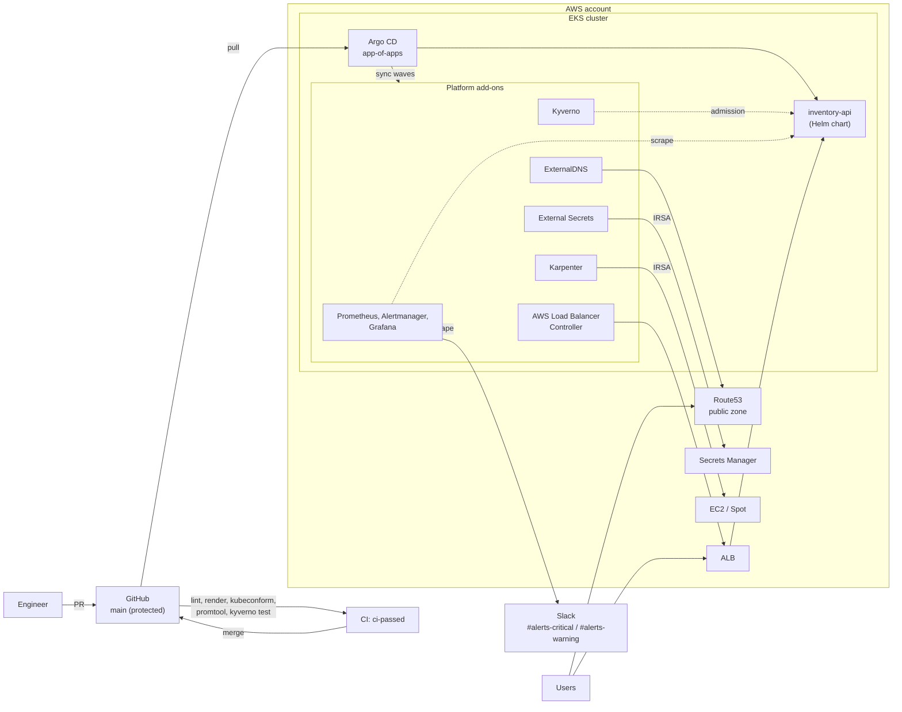
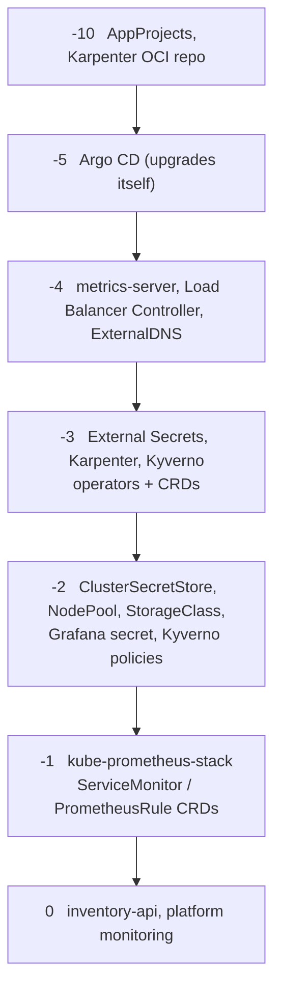

# ipshita_eks_helm_platform

[](https://github.com/IpshitaChaudhary/ipshita_eks_helm_platform/actions/workflows/ci.yml)
[](https://github.com/IpshitaChaudhary/ipshita_eks_helm_platform/releases)


A complete platform for running workloads on **Amazon EKS** the way I run them in production:
secure by default, observable, and safe to roll out and roll back. Everything is in Git and
delivered by Argo CD, and every change is rendered, schema-validated and unit-tested in CI before
it can merge.

What is in it:

- **An application chart** (`inventory-api`): hardened pods, IRSA, HPA, PDB, ALB Ingress,
  default-deny NetworkPolicy, ServiceMonitor, SLO burn-rate alerts and a Grafana dashboard.
- **The EKS add-ons**: AWS Load Balancer Controller, ExternalDNS, metrics-server, External Secrets,
  Karpenter, kube-prometheus-stack and Kyverno, each with pinned versions and reviewed values.
- **GitOps**: an Argo CD app-of-apps that brings the cluster up in order with sync waves and
  manages its own upgrades.
- **A platform that watches itself**: alerts and dashboards for every add-on, routed to Slack by
  severity.

The EKS cluster itself is built with the `eks` module from
[ipshita_terraform_infrastructure_module](https://github.com/IpshitaChaudhary/ipshita_terraform_infrastructure_module).
This repo covers what runs **on** the cluster.

## Architecture



Argo CD pulls from `main`; nobody runs `kubectl apply` against the cluster. Every add-on reaches
AWS through its own IRSA role, and Prometheus scrapes the add-ons as well as the app, so a broken
controller pages like a broken service.

## Layout

```
charts/
  inventory-api/     # application chart (the Node.js API from jenkins-ci-cd-pipeline)
platform/            # cluster add-ons: pinned values, manifests and an ordered install.sh
  kube-prometheus-stack/platform-monitoring/   # ServiceMonitors, alerts, dashboards for the add-ons
  kyverno/policies/  # ClusterPolicies for app namespaces (+ kyverno/tests/)
gitops/              # Argo CD app-of-apps: bootstrap.sh, root app, projects, one Application per add-on/app
.github/workflows/   # CI: helm lint/render, kubeconform, promtool, amtool, kyverno test, drift checks
```

## Quick start

```bash
helm lint charts/inventory-api --strict
helm template demo charts/inventory-api -f charts/inventory-api/ci/production-values.yaml
```

See [charts/inventory-api/README.md](charts/inventory-api/README.md) for install and values.

## GitOps with Argo CD

Two ways to install the platform, from the same pinned chart versions and values files:

- `platform/install.sh`: imperative, for a cluster without Argo CD.
- `gitops/bootstrap.sh`: installs Argo CD only and applies `gitops/root-app.yaml`. From then on Argo CD
  installs and upgrades everything from `main`, including itself. Changes go through a PR, never `kubectl`.

```bash
./gitops/bootstrap.sh --dry-run   # render only
./gitops/bootstrap.sh             # install Argo CD and hand the cluster to Git
```

Sync waves bring the cluster up in order, and Argo CD waits for each wave to be Healthy:



Each arrow is a wait: a wave starts only when every Application in the one before is Healthy
(the health check for Applications is restored in `platform/argo-cd/values.yaml`), so no
resource is applied before the CRD, webhook or Secret it needs.


| Wave | What |
|---|---|
| -10 | AppProjects `platform` and `apps`, Karpenter OCI repository |
| -5 | Argo CD (manages its own upgrades) |
| -4 | metrics-server, AWS Load Balancer Controller, ExternalDNS |
| -3 | External Secrets, Karpenter, Kyverno (operators + CRDs) |
| -2 | ClusterSecretStore, EC2NodeClass + NodePool, monitoring StorageClass + Grafana secret, Kyverno policies |
| -1 | kube-prometheus-stack (its CRDs must exist before apps ship ServiceMonitors) |
| 0 | inventory-api + its ExternalSecret, platform monitoring (ServiceMonitors, alerts, dashboards) |

Per cluster, only the values in `gitops/apps/*.yaml` change (cluster name, region, VPC, IRSA role ARNs);
CI fails if an Application and `install.sh` pin different chart versions.

## Principles

- **Secure defaults, opt-out not opt-in.** Non-root, read-only root filesystem, all capabilities dropped,
  `RuntimeDefault` seccomp, no service-account token unless the pod needs AWS access.
- **AWS access through IRSA**, never node-role permissions or static keys in values files.
- **Zero-downtime rollouts.** `maxUnavailable: 0`, readiness probes, PodDisruptionBudget,
  spread across nodes and AZs.
- **Everything renders in CI.** Every chart change is linted, templated and validated against the
  Kubernetes schema before it can merge.
- **Alerts are code too.** Alert rules ship with the app chart, routing lives in the platform values,
  CI unit-tests the rules with `promtool` and proves where each severity lands before a change merges.
- **Page on the error budget, not on thresholds.** Burn-rate alerts against an SLO page when users
  are really affected, and stay quiet for blips the budget can absorb.
- **Guardrails are enforced, not suggested.** What the app chart does by default (restricted Pod
  Security, pinned image tags, requests and a memory limit, readiness probes) is a Kyverno policy for
  every app namespace, unit-tested in CI, and the chart is checked against it on every PR.
- **No secrets in Git.** Charts reference existing Secrets (or External Secrets); values files never carry credentials.

## Roadmap

| Step | Status |
|---|---|
| Repo skeleton | Done |
| `inventory-api` chart: Deployment, Service, ServiceAccount (IRSA) | Done |
| HPA, PDB, ALB Ingress, NetworkPolicy, values schema | Done |
| CI: `helm lint`, `helm template` + kubeconform, negative tests | Done |
| Platform add-ons: AWS Load Balancer Controller, metrics-server, External Secrets, Karpenter | Done |
| CI: shellcheck, render every pinned add-on chart, CRD schema validation | Done |
| GitOps with Argo CD (app-of-apps), AppProjects, sync waves | Done |
| CI: render Argo CD, validate Applications, chart version drift check | Done |
| Observability: kube-prometheus-stack, ServiceMonitor, PrometheusRule alerts | Done |
| CI: CRD validation for monitoring resources, chart version drift check | Done |
| Grafana dashboards as code, Alertmanager routing to Slack by severity | Done |
| CI: dashboard JSON checks, `amtool check-config` + route tests | Done |
| Availability SLO: SLI recording rules, multi-window burn-rate alerts | Done |
| CI: `promtool check rules` + alert unit tests | Done |
| Platform self-monitoring: External Secrets + Karpenter scraping and alerts, unit-tested | Done |
| Platform dashboards as code (Karpenter, External Secrets), shipped with kustomize | Done |
| Policy guardrails: Kyverno + 5 ClusterPolicies for app namespaces, alerts | Done |
| CI: `kyverno test` per policy, chart checked against the policies | Done |
| First release (`v0.1.0`), see [CHANGELOG.md](CHANGELOG.md) | Done |
| ExternalDNS: Route53 records for Ingress hosts, owned per cluster, alerts | Done |
| Argo CD self-monitoring: metrics, sync/health alerts (unit-tested), dashboard | Done |
| Architecture and sync-wave diagrams, badges; release `v0.2.0` | Done |

The platform is complete: everything on the roadmap is done and released. Changes from here are
version bumps of the pinned charts, made the same way: PR, green CI, merge, Argo CD syncs.
